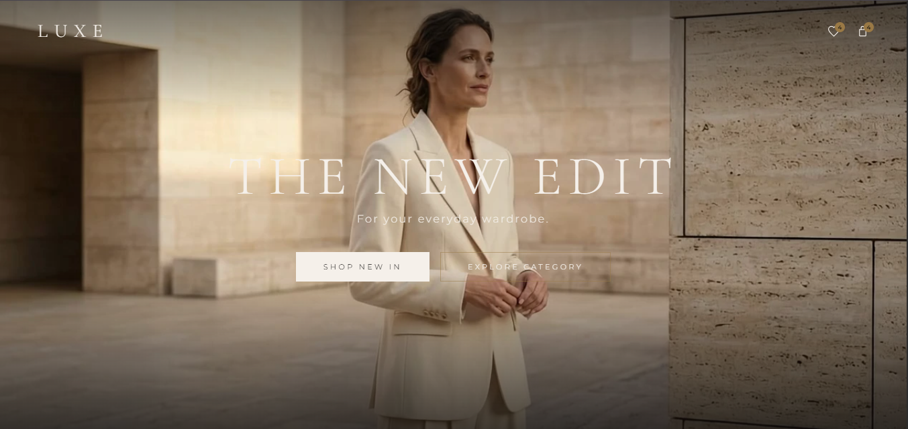
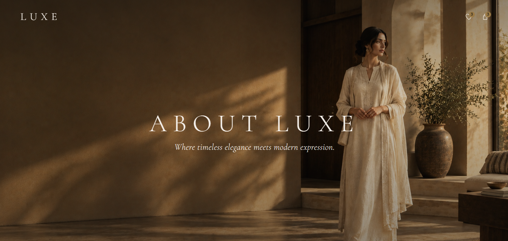
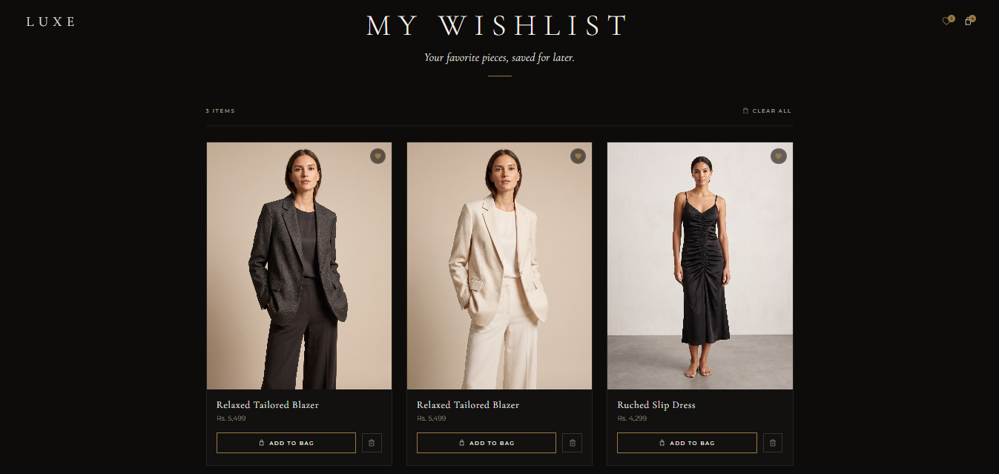
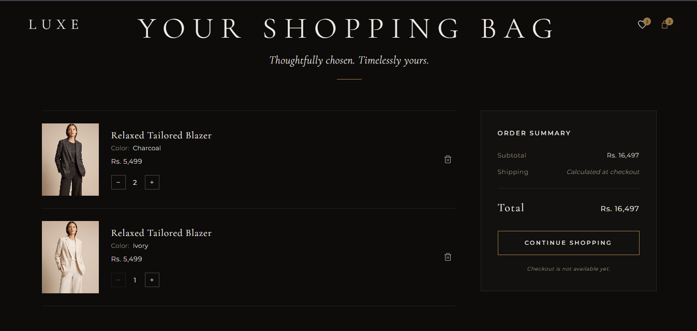
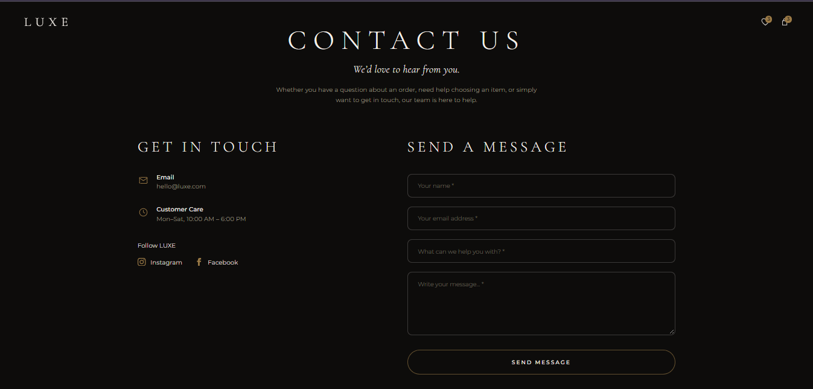

# LUXE — Premium Women's Fashion

A modern women's fashion e-commerce frontend focused on elegant design, premium imagery, and a refined shopping experience.

🌐 Live Website: View LUXE

## 🖥️ Homepage Preview

## ✨ Features

- Scroll-based animated hero section
- Women's fashion categories
- New arrivals with interactive color swatches
- Wishlist interface
- Shopping bag interface
- About and Contact pages
- Privacy Policy and Terms & Conditions
- Responsive, luxury-inspired visual design

## 📸 Website Screenshots

### About LUXE

### Wishlist

### Shopping Bag

### Contact

## 🛠️ Technologies Used

- HTML5
- CSS3
- JavaScript

## 📂 Project Structure

- `index.html` — Homepage
- `hero.js` — Hero animation
- `assets/` — Website images and animation frames
- `pages/` — About, Contact, Wishlist, Bag, and policy pages

## 🚧 Project Status

Frontend demonstration project. Backend functionality, authentication, and payment processing are not implemented.

## 👩‍💻 Author

**Alishba Iftikhar**

- GitHub: [@aalishbaifftikhar](https://github.com/aalishbaifftikhar)
- Project: [LUXE Repository](https://github.com/aalishbaifftikhar/LUXE)
